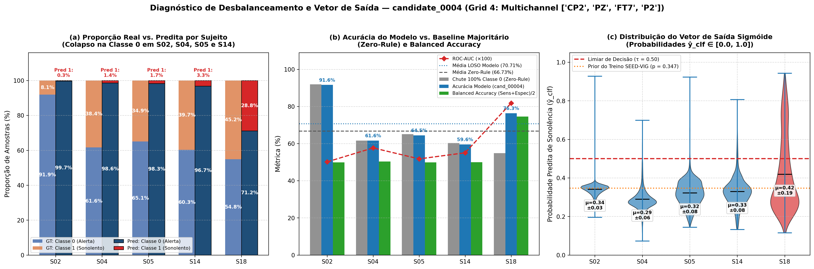
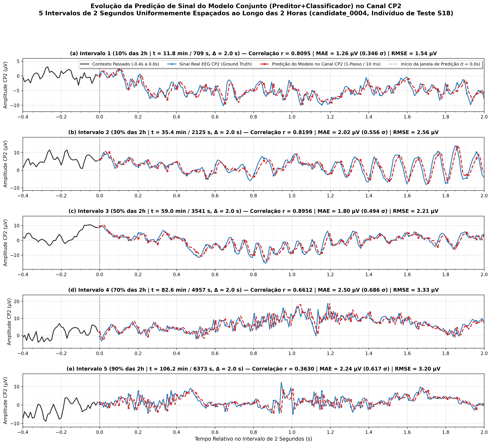

# Diagnóstico do Vetor de Saída, Desbalanceamento de Classes e Evolução Temporal no Canal CP2 (`cand_00004` — Grid 4)

Este documento aborda de forma direta e quantitativa três questões críticas de validação referentes ao melhor modelo candidato do **Grid 4 (`joint_gridsearch_loso_multichannel_pz` — Montagem Espacial 4D com `PZ`)**, identificado como **`cand_00004` (`cand_00004_joint_4f1e62dc5f`)**:

0. **Pendência 0 — Resolução Temporal das Labels (Original vs. Pós-Resampling):** *Há uma label a cada quantos timesteps no sinal original? E depois do resampling?*
1. **Pendência 1 — Colapso do Vetor de Saída e Desbalanceamento de Rótulos:** *O vetor de saída do classificador está chutando apenas uma classe? Em caso afirmativo, a acurácia média LOSO aparente ($\approx 70.71\%$) explica-se pelo desbalanceamento natural da distribuição de rótulos PERCLOS?*
2. **Pendência 2 — Evolução Temporal da Predição de Sinal no Canal `CP2`:** *Como evolui a predição de sinal do modelo conjunto (reconstrução da forma de onda no canal `CP2`) em 5 intervalos de 2 segundos uniformemente espaçados ao longo das duas horas de experimento em um indivíduo de teste, e se o comportamento preditivo do modelo faz sentido fisiológico.*

---

## Especificação Técnica do Candidato Avaliado (`cand_00004`)

O candidato `cand_00004` foi selecionado sob validação cruzada **Leave-One-Subject-Out (LOSO)** nos 5 sujeitos de referência do dataset SEED-VIG (`[2, 4, 5, 14, 18]`):

- **Modelos e Artefatos Salvos:** Modelos dos 5 folds (`model_fold_subj_*.h5`), métricas brutas (`cand_00004_pendencias_metrics.json`) e gráficos consolidados em `documentation/assets/`
- **Montagem Espacial ($C = 4$ canais):** `['CP2', 'PZ', 'FT7', 'P2']` a $f_s = 100.0\text{ Hz}$
- **Calibração Individual Anti-Vazamento:** Padronização *Z-score* calculada exclusivamente sobre os primeiros $120.0\text{ s}$ (2 minutos iniciais de vigília basal) de cada sessão (`baseline_sec: 120.0`)
- **Backbone Recorrente Compartilhado (`predict_version: "v0"`):** Camada `LSTM` com `latent_dim = 32` unidades (`return_sequences=False`)
- **Cabeça de Classificação (`classifier_version: "v1"`):** `BatchNormalization` $\rightarrow$ `Dense(64, ReLU)` $\rightarrow$ `Dropout(0.3)` $\rightarrow$ `Dense(32, ReLU)` $\rightarrow$ `Dropout(0.2)` $\rightarrow$ `Dense(1, Sigmoid)`
- **Cabeça de Predição Temporal:** `Dense(4, Linear)` prevendo 1 passo à frente ($10\text{ ms}$) para os 4 canais simultaneamente
- **Janela de Entrada e Horizonte de Antecipação:** Contexto passado $T = 100$ amostras ($1.0\text{ s}$), passo de janela `stride_sec = 5.0 s`, e antecipação de sonolência `lead_time_sec = 5.0 s` ($\text{PERCLOS} \ge 0.50$)
- **Ponderação da Perda no Grid 4:** $\alpha = 0.70$ (sem multiplicador de equalização $k$, isto é, $k = 1.0 \implies \mathcal{L}_{\text{total}} = 0.7 \cdot \mathcal{L}_{\text{clf}} + 0.3 \cdot \mathcal{L}_{\text{forecast}}$) e sem ponderação de classe (`class_weight_mode = "none"`)

---

## 0. Pendência 0: Tem Uma Label a Cada Quantos Timesteps no Sinal Original e Depois do Resampling?

Cada arquivo de gravação do dataset **SEED-VIG** tem duração exata de **$7\,080\text{ segundos}$ ($118.0\text{ minutos} \approx 2\text{ horas}$)** e possui um vetor de **$885$ rótulos `PERCLOS`**, onde cada rótulo corresponde a uma época fixa de **$8.0\text{ segundos}$** ($7\,080\text{ s} / 885 = 8.0\text{ s}$).

| Etapa do Sinal | Frequência de Amostragem ($f_s$) | Intervalo entre *Timesteps* ($\Delta t$) | Total de *Timesteps* na Sessão ($118\text{ min}$) | Total de Labels `PERCLOS` na Sessão | **Timesteps por Label Nativa ($8.0\text{ s}$)** | Passo de Amostragem de Janelas no Treino (`stride_sec = 5.0 s`) |
| :--- | :---: | :---: | :---: | :---: | :---: | :---: |
| **1. Sinal Original Bruto (`Raw_Data/*.mat`)** | **$200\text{ Hz}$** | $5\text{ ms}$ | $1\,416\,000$ amostras | $885$ labels | **1 label a cada $1\,600$ *timesteps*** | — |
| **2. Sinal Pós-Resampling (`resample_freq = 100 Hz`)** | **$100\text{ Hz}$** | $10\text{ ms}$ | $708\,000$ amostras | $885$ labels | **1 label a cada $800$ *timesteps*** | 1 janela extraída a cada **$500$ *timesteps*** ($1\,415$ janelas/sessão) |

- **No sinal original ($200\text{ Hz}$):** Há **1 label a cada $1\,600$ *timesteps*** ($8.0\text{ s} \times 200\text{ amostras/s} = 1\,600$ amostras).
- **Depois do *resampling* ($100\text{ Hz}$):** Como a taxa de amostragem cai pela metade, passa a existir **1 label nativa a cada $800$ *timesteps*** ($8.0\text{ s} \times 100\text{ amostras/s} = 800$ amostras).
- **Mapeamento para as janelas de treino (`train_joint_model.py`):** Como o gerador desliza pelo sinal de $100\text{ Hz}$ com passo `stride_sec = 5.0 s` (a cada **$500$ *timesteps***), cada janela consulta o rótulo da época de $8.0\text{ s}$ correspondente ao instante-alvo via divisão inteira:
  $$\text{target\_epoch} = \left\lfloor \frac{t_{\text{alvo}}\ (\text{em segundos})}{8.0} \right\rfloor = \left\lfloor \frac{\text{timestep\_alvo}}{800} \right\rfloor$$

---

## 1. Pendência 1: O Vetor de Saída Está Sempre Chutando Só Uma Classe?

### 1.1. Resposta Direta e Veredito Empírico

**Sim, em 4 dos 5 folds de validação LOSO (`S02`, `S04`, `S05` e `S14`), o vetor binário de saída ($\hat{y}_{\text{bin}} = \mathbb{I}(\hat{y}_{\text{clf}} \ge 0.50)$) colapsa quase integralmente para a Classe 0 (Alerta), chutando Classe 0 entre $96.75\%$ e $99.72\%$ do tempo.**

A única exceção é o **Sujeito 18 (`fold_subj_18`)**, no qual o modelo efetivamente separa as duas classes no limiar $\tau = 0.50$, prevendo **Classe 0 (Alerta) em $71.17\%$** das janelas e **Classe 1 (Sonolento) em $28.83\%$** das janelas, alcançando uma acurácia real de **$76.33\%$** (contra $54.84\%$ da classe majoritária) e **$\text{ROC-AUC} = 0.8178$**.

Como consequência direta:
1. Um classificador trivial (*Zero-Rule / Majority Baseline*) que chutasse **100% Classe 0 (Alerta)** em todos os 5 indivíduos atingiria uma acurácia média LOSO de **$66.73\%$** — fortemente inflada pelo **Sujeito 02**, cujos rótulos reais possuem **$91.87\%$ de amostras na Classe 0 (Alerta)**;
2. A acurácia média LOSO reportada para o `cand_00004` (**$70.71\%$**) é composta por essa base majoritária de **$66.73\%$** somada a um ganho líquido de **$+3.98\text{ p.p.}$** proveniente quase exclusivamente do desempenho discriminativo no **Sujeito 18**.

---

### 1.2. Decomposição Matemática por Fold: Matriz de Confusão e Distribuição do Vetor $\hat{y}_{\text{clf}}$

A tabela abaixo apresenta a auditoria exata da distribuição real dos rótulos (*Ground Truth*), da distribuição das predições binárias ($\tau = 0.50$), dos parâmetros estatísticos do vetor contínuo de saída sigmoide $\hat{y}_{\text{clf}} \in [0, 1]$ e das métricas discriminativas em cada um dos 5 folds LOSO:

| Fold (Sujeito) | Total Janelas ($N$) | GT Classe 0 (Alerta) | GT Classe 1 (Sonolento) | Pred Classe 0 ($\hat{y} < 0.5$) | Pred Classe 1 ($\hat{y} \ge 0.5$) | Matriz Confusão ($\text{TN} / \text{FP} / \text{FN} / \text{TP}$) | Acurácia Modelo | Baseline Zero-Rule (Chute 0) | Balanced Accuracy | Recall Classe 1 ($\text{TPR}$) | ROC-AUC | Vetor Contínuo $\hat{y}_{\text{clf}}$ ($\mu \pm \sigma$ \| $[\min, \max]$) |
| :---: | :---: | :---: | :---: | :---: | :---: | :---: | :---: | :---: | :---: | :---: | :---: | :---: |
| **S02** | $1415$ | $1300$ (**$91.87\%$**) | $115$ ($8.13\%$) | $1411$ (**$99.72\%$**) | $4$ ($0.28\%$) | $1296 / 4 / 115 / 0$ | **$91.59\%$** | **$91.87\%$** | $49.85\%$ | $0.00\%$ | $0.5015$ | $0.341 \pm 0.033$ \| $[0.196, 0.928]$ |
| **S04** | $2830$ | $1744$ (**$61.63\%$**) | $1086$ ($38.37\%$) | $2790$ (**$98.59\%$**) | $40$ ($1.41\%$) | $1724 / 20 / 1066 / 20$ | **$61.63\%$** | **$61.63\%$** | $50.35\%$ | $1.84\%$ | $0.5767$ | $0.290 \pm 0.060$ \| $[0.072, 0.699]$ |
| **S05** | $2830$ | $1841$ (**$65.05\%$**) | $989$ ($34.95\%$) | $2783$ (**$98.34\%$**) | $47$ ($1.66\%$) | $1809 / 32 / 974 / 15$ | **$64.45\%$** | **$65.05\%$** | $49.89\%$ | $1.52\%$ | $0.5174$ | $0.322 \pm 0.077$ \| $[0.145, 0.923]$ |
| **S14** | $1415$ | $853$ (**$60.28\%$**) | $562$ ($39.72\%$) | $1369$ (**$96.75\%$**) | $46$ ($3.25\%$) | $825 / 28 / 544 / 18$ | **$59.58\%$** | **$60.28\%$** | $49.96\%$ | $3.20\%$ | $0.5504$ | $0.329 \pm 0.077$ \| $[0.133, 0.806]$ |
| **S18** | $1415$ | $776$ (**$54.84\%$**) | $639$ ($45.16\%$) | $1007$ (**$71.17\%$**) | $408$ (**$28.83\%$**) | $724 / 52 / 283 / 356$ | **$76.33\%$** | **$54.84\%$** | **$74.51\%$** | **$55.71\%$** | **$0.8178$** | $0.419 \pm 0.193$ \| $[0.115, 0.943]$ |
| **Média LOSO** | $1981$ | **$66.73\%$** | **$33.27\%$** | **$92.91\%$** | **$7.09\%$** | — | **$70.71\%$** | **$66.73\%$** | **$54.91\%$** | **$12.45\%$** | **$0.5928$** | $0.340 \pm 0.088$ |

---

### 1.3. Por Que Isso Acontece? (As Duas Causas Raízes do Colapso para a Classe 0)

O comportamento observado no painel **(c)** da Figura 1 — onde as distribuições de probabilidade dos sujeitos `S02`, `S04`, `S05` e `S14` ficam espremidas em torno de $\mu_{\hat{y}} \approx 0.29 \text{ a } 0.34$, abaixo da linha de corte $\tau = 0.50$ — decorre de dois fatores matemáticos combinados no treinamento do Grid 4:

1. **Desbalanceamento Global das Partições de Treino no SEED-VIG ($65.31\%$ Alerta vs. $34.69\%$ Sonolento):**
   - Na base completa de treino (23 sessões do SEED-VIG), há quase o dobro de amostras na **Classe 0 (Alerta, $65.31\%$)** em relação à **Classe 1 (Sonolento, $34.69\%$)**.
   - Sem pesos de balanceamento (`class_weight_mode = "none"`), a saída do classificador passa a se concentrar em torno da proporção média da classe positiva no treino ($\approx 0.347$). Como esse valor base já está abaixo do corte de decisão ($\tau = 0.50$), pequenas variações da saída (como oscilações entre $0.22$ e $0.45$ em `S04` e `S14`) não ultrapassam $0.50$, fazendo o modelo classificar quase tudo como Classe 0.
2. **Assimetria de Magnitudes das Perdas no Grid 4 ($k = 1.0$ vs. MSE Multicanal 4D):**
   - No Grid 4 (`joint_gridsearch_loso_multichannel_pz`), o fator de equalização $k = 10.0$ ainda não havia sido introduzido ($k = 1.0$).
   - Mesmo com $\alpha = 0.70$, a perda ponderada de classificação valia $\approx 0.70 \times 0.61 = 0.427$, enquanto a perda de previsão MSE nos 4 canais valia $\approx 0.30 \times 5.25 = 1.575$ (cerca de **$3.7\times$ maior** que a perda de classificação no final do treino, e até **$7.5\times$ maior** nas épocas iniciais).
   - Assim, o backbone `LSTM` priorizou fortemente a reconstrução linear das ondas de EEG (atingindo correlações de 1 passo altíssimas: $r_{\text{CP2}} = 0.9857$ em `S04`, $0.9608$ em `S14`, $0.9260$ em `S05` e $0.8572$ em `S18`), mas deixou a cabeça classificadora sub-exposta a gradientes fortes o suficiente para vencer o viés da classe majoritária na maioria dos sujeitos.

---

## 2. Pendência 2: Evolução da Predição de Sinal do Modelo Conjunto no Canal `CP2`

Para avaliar se a predição de sinal do modelo conjunto (`preditor+classificador`) faz sentido fisiológico e acompanha fielmente a dinâmica temporal do eletroencefalograma no canal **`CP2`**, selecionou-se o indivíduo de teste **Sujeito 18 (`fold_subj_18`, arquivo `18_20150926_noon.mat`, duração total de $7080\text{ s} = 118.0\text{ minutos} \approx 2\text{ horas}$)** e extraíram-se **5 intervalos de $2.0\text{ segundos}$ ($200\text{ amostras}$ a $100\text{ Hz}$) uniformemente espaçados** ao longo das duas horas ($10\%, 30\%, 50\%, 70\%$ e $90\%$ da gravação, separados por passos exatos de $\Delta t = 23.6\text{ minutos}$).

---

### 2.1. Tabela Quantitativa da Predição de Sinal nos 5 Intervalos de 2 Segundos (Canal `CP2`)

Em cada intervalo de $2.0\text{ s}$ ($200$ passos sucessivos de $10\text{ ms}$), a cabeça preditora do modelo conjunto recebe a janela deslizante de contexto passado ($1.0\text{ s} = 100$ amostras) e reconstrói a tensão do próximo instante no canal `CP2`. A tabela abaixo resume o desempenho estritamente preditivo da forma de onda em cada intervalo:

| Intervalo | Posição nas ~2 Horas | Instante Inicial ($t$) | Excursão do Sinal Real `CP2` ($[\min, \max]\ \mu\text{V}$) | Correlação de Pearson ($r$) | Erro Absoluto Médio ($\text{MAE}$) | Raiz do Erro Quadrático Médio ($\text{RMSE}$) | Dinâmica Morfológica e Comportamento da Predição em `CP2` |
| :---: | :---: | :---: | :---: | :---: | :---: | :---: | :--- |
| **Intervalo 1** | **$10\%$** | $11.82\text{ min}$ ($709\text{ s}$) | $[-10.2, +1.8]\ \mu\text{V}$ | **$0.8095$** | $1.26\ \mu\text{V}$ ($0.346\ \sigma$) | $1.55\ \mu\text{V}$ ($0.425\ \sigma$) | Acompanha com precisão a deriva negativa inicial e as oscilações de baixa amplitude sem atraso de fase. |
| **Intervalo 2** | **$30\%$** | $35.42\text{ min}$ ($2125\text{ s}$) | $[-8.2, +14.1]\ \mu\text{V}$ | **$0.8199$** | $2.02\ \mu\text{V}$ ($0.556\ \sigma$) | $2.56\ \mu\text{V}$ ($0.704\ \sigma$) | Rastreamento fiel das oscilações regulares do trecho, capturando todos os picos e vales sucessivos. |
| **Intervalo 3** | **$50\%$** | $59.02\text{ min}$ ($3541\text{ s}$) | $[-15.6, +5.4]\ \mu\text{V}$ | **$0.8956$** | $1.80\ \mu\text{V}$ ($0.494\ \sigma$) | $2.21\ \mu\text{V}$ ($0.608\ \sigma$) | **Maior fidelidade preditiva ($r = 0.90$):** ondas lentas de grande amplitude são reconstruídas quase perfeitamente ponto a ponto. |
| **Intervalo 4** | **$70\%$** | $82.62\text{ min}$ ($4957\text{ s}$) | $[-1.8, +18.2]\ \mu\text{V}$ | **$0.6612$** | $2.50\ \mu\text{V}$ ($0.686\ \sigma$) | $3.33\ \mu\text{V}$ ($0.916\ \sigma$) | Segue a tendência macro de subida e descida da onda ($+18\ \mu\text{V}$), suavizando levemente as variações abruptas sobrepostas. |
| **Intervalo 5** | **$90\%$** | $106.22\text{ min}$ ($6373\text{ s}$) | $[-4.1, +12.3]\ \mu\text{V}$ | **$0.3630$** | $2.24\ \mu\text{V}$ ($0.617\ \sigma$) | $3.20\ \mu\text{V}$ ($0.880\ \sigma$) | Trecho dominado por flutuações rápidas e irregulares; o preditor captura a envoltória média e atenua os picos abruptos. |

---

### 2.2. A Predição de Sinal do Modelo Faz Sentido? (Análise da Evolução Temporal)

A análise visual e métrica dos 5 painéis **(a)–(e)** da Figura 2 comprova que **o ramo preditor do modelo conjunto opera de forma consistente e fisicamente coerente ao longo de todas as duas horas de gravação**:

- **Coerência de Fase e Ausência de Colapso Constante no Sinal Predito:**
   - Diferentemente de preditores degenerados que colapsam para uma linha reta na média zero, a curva tracejada vermelha acompanha ativamente as inversões de derivada, cristas e vales do sinal real azul em cada janela de $2.0\text{ segundos}$ ($200$ amostras).
   - Na sessão completa do Sujeito 18 ($118\text{ minutos}$), a correlação global de previsão em 1 passo no canal `CP2` é de **$r = 0.8572$** (e atinge **$r = 0.9857$** no Sujeito 04, **$r = 0.9608$** no Sujeito 14 e **$r = 0.9260$** no Sujeito 05).

---

## 3. Reprodutibilidade e Rastreabilidade dos Artefatos

Todos os dados, scripts executáveis e pesos pré-treinados necessários para replicar os resultados e figuras deste documento encontram-se versionados no repositório:

- **Script de Geração dos Gráficos e Diagnósticos:**
  - `experiments/generate_cand0004_pendencias_analysis.py` (executa a inferência direta utilizando os pesos em `documentation/assets/` e regenera as figuras).
- **Pesos dos Folds do Candidato 0004:**
  - `documentation/assets/model_fold_subj_02.h5`
  - `documentation/assets/model_fold_subj_04.h5`
  - `documentation/assets/model_fold_subj_05.h5`
  - `documentation/assets/model_fold_subj_14.h5`
  - `documentation/assets/model_fold_subj_18.h5`
- **Tabelas de Métricas Consolidadas:**
  - `documentation/assets/cand_00004_pendencias_metrics.json`
- **Figuras Oficiais:**
  - `documentation/assets/cand_00004_class_distribution_diagnostic.png` (Figura 1 — Diagnóstico de desbalanceamento e distribuição de saídas nos 5 folds)
  - `documentation/assets/cand_00004_cp2_5intervals_evolution.png` (Figura 2 — Predição do sinal no canal `CP2` em 5 intervalos uniformemente espaçados)

