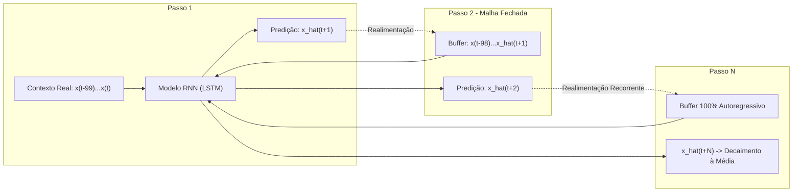

# Investigação Experimental da Predição e Rollout Autoregressivo de Sinais EEG Contínuos com Redes Neurais Recorrentes (LSTM e GRU)

**Autor:** Pedro Ulisses Quadros  
**Projeto:** `scalogram_cnn_project`  
**Colaboração:** Compartilhado com Sarah  
**Data:** Outubro de 2026  
**Status do Módulo:** Concluído / Validado Experimentalmente  

---

## Resumo Executivo

Este documento relata formalmente a fundamentação teórica, a metodologia experimental, os resultados quantitativos e os diagnósticos da investigação sobre **predição autoregressiva e rollout em malha fechada (*closed-loop*) de sinais eletroencefalográficos (EEG) brutos**.

O objetivo primário desta vertente foi avaliar a viabilidade de utilizar modelos neurais recorrentes (*Long Short-Term Memory* - LSTM e *Gated Recurrent Unit* - GRU) treinados sob auto-supervisão para prever pontos futuros da série temporal contínua de EEG (canais centrais e parietais como CP2, Pz, O1), explorando:
1. A capacidade preditiva em horizontes ultra-curtos (*one-step*, 10 ms a 100 Hz);
2. A degradação do sinal ao expandir o horizonte de predição direta (de 10 ms até 500 ms nos Grids 6, 7 e 8);
3. O comportamento dinâmico do **rollout autoregressivo iterativo** (onde previsões passadas são recursivamente realimentadas como entrada até 5,0 segundos à frente);
4. As implicações dessa dinâmica na representação latente para o modelo conjunto de classificação de sonolência (*Joint Forecasting + Classification*).

---

## 1. Fundamentação Teórica

### 1.1 Natureza Estocástica e Caótica dos Sinais EEG
O sinal de EEG de superfície é o somatório espaço-temporal dos potenciais pós-sinápticos sincronizados de milhões de neurônios piramidais corticais, atenuados e convoluídos pelas camadas biológicas (líquor, meninges, osso craniano e couro cabeludo) [Niedermeyer & da Silva, 2005]. Esse processo confere ao EEG características matemáticas complexas:
- **Não-estacionariedade acentuada:** Mudanças contínuas de média e variância ao longo dos estados comportamentais (ex.: transição de vigília para sonolência);
- **Multi-escala espectral:** Coexistência de ritmos fisiológicos lentos ($\delta: 0.5-4\text{ Hz}$, $\theta: 4-8\text{ Hz}$, $\alpha: 8-13\text{ Hz}$) e rápidos ($\beta: 13-30\text{ Hz}$, $\gamma: >30\text{ Hz}$);
- **Sensibilidade a perturbações e micro-artefatos:** Piscadas oculares, atividade eletromiográfica craniana e ruído instrumental.

Em modelagem clássica de séries temporais [Box et al., 2015], um processo autoregressivo de ordem $p$ ($AR(p)$) formula o valor no instante $t$ como uma combinação linear dos $p$ estados anteriores acrescido de um termo de ruído branco estocástico:
$$x_t = c + \sum_{i=1}^p \phi_i x_{t-i} + \epsilon_t, \quad \epsilon_t \sim \mathcal{N}(0, \sigma^2)$$

### 1.2 Formulação Não-Linear via Redes Neurais Recorrentes (RNN)
As redes neurais recorrentes estendem essa formulação para mapeamentos não-lineares arbitrários, mantendo um vetor de estado latente oculto $h_t \in \mathbb{R}^d$ que codifica recursivamente o histórico temporal [Hochreiter & Schmidhuber, 1997; Cho et al., 2014]:

$$\begin{aligned}
h_t &= \text{RNNCell}(x_t, h_{t-1}) \\
\hat{y}_{t+1} &= W_y h_t + b_y
\end{aligned}$$

Em nossa formulação direta (*Direct Projection*), o modelo recebe uma janela temporal normalizada contendo $K$ timesteps passados $X = [x_{t-K+1}, x_{t-K+2}, \dots, x_t] \in \mathbb{R}^{K \times 1}$ e mapeia diretamente para $H$ timesteps futuros através de uma projeção densa linear sobre o vetor de estado final $h_t$:

$$\hat{Y} = [\hat{x}_{t+1}, \hat{x}_{t+2}, \dots, \hat{x}_{t+H}] = \text{Dense}(h_t) \in \mathbb{R}^{H \times 1}$$

A função de perda é o Erro Quadrático Médio (*Mean Squared Error* - MSE):
$$\mathcal{L}_{\text{MSE}} = \frac{1}{H} \sum_{k=1}^H (x_{t+k} - \hat{x}_{t+k})^2$$

---

## 2. Metodologia Experimental e Protocolo Anti-Vazamento

### 2.1 Base de Dados e Canal Alvo
- **Dataset Principal:** SEED-VIG (*SJTU Emotion EEG Dataset - Vigilance Estimation*) [Zheng & Lu, 2017].
- **Frequência de Amostragem:** Originalmente 200 Hz, reamostrado para $f_s = 100.0\text{ Hz}$ via decimação anti-aliasing com filtro de fase linear. Isso garante preservação integral dos ritmos cerebrais até 50 Hz (frequência de Nyquist), cobrindo as faixas $\delta, \theta, \alpha, \beta$ e parte de $\gamma$.
- **Canal Eletrofisiológico:** Eletrodo parietal-central `CP2` (associado a ritmos de vigília, fusos de sono e atividade teta/alfa sincronizada) e derivações centrais (`Cz`, `Pz`, `Fz`).

### 2.2 Protocolo Rigoroso de Prevenção de Data Leakage
Para evitar superestimativas espúrias decorrentes de contaminação temporal:
1. **Particionamento Cronológico Estrito:** Para cada sessão/sujeito contínuo, os primeiros $80\%$ do sinal são alocados exclusivamente para o conjunto de treinamento, e os $20\%$ finais para validação/teste.
2. **Rejeição do Gap de Transição (*Transition Gap Rejection*):** As janelas deslizantes que intersectam a fronteira de divisão (treino/teste) são rigorosamente descartadas:
   $$\text{neglected\_windows} = \left\lceil \frac{T_{in} + T_{out}}{\text{stride}} \right\rceil$$
3. **Padronização $z$-Score Isolada:** As estatísticas de normalização ($\mu_{\text{train}}$, $\sigma_{\text{train}}$) são calculadas **exclusivamente na partição de treino**:
   $$z_t = \frac{x_t - \mu_{\text{train}}}{\max(\sigma_{\text{train}}, 10^{-6})}$$
   A partição de teste é normalizada aplicando-se rigorosamente esses mesmos $(\mu_{\text{train}}, \sigma_{\text{train}})$.
4. **Desnormalização Física ($\mu\text{V}$):** Ao final, as predições em unidades padronizadas são projetadas de volta à escala bioelétrica original em microvolts ($\mu\text{V}$):
   $$\hat{y}_{\text{phys}} = \hat{z} \cdot \sigma_{\text{train}} + \mu_{\text{train}}$$

---

## 3. Exploração Sistemática por Hiperparâmetros (Grids 6, 7 e 8)

Foram executadas três baterias completas de busca em grade (*grid search*) na máquina local (equipamento com GPU dedicada NVIDIA RTX), perfazendo mais de 270 modelos avaliados:

### 3.1 Grid 6: Prova de Conceito 1-Passo (10 ms à Frente a 100 Hz)
- **Configuração:** 144 modelos avaliados (`configs/hyperparameter_search_rnn/forecast_grid_6_1step_100hz.yaml`).
- **Arquiteturas:** LSTM (v0) vs GRU (v1).
- **Dimensões Latentes:** 16, 32 e 64 unidades.
- **Otimizadores:** Adam vs RMSprop.
- **Taxas de Aprendizado:** $0.0001, 0.0005, 0.001$.
- **Janela de Contexto:** $1.0\text{ s}$ (100 passos). Horizonte: $1\text{ passo}$ (10 ms). Stride: 3 passos. Épocas: 20. Batch size: 64.

#### Resultados Notáveis do Grid 6:
- **Melhor Modelo Global:** `model_6e3550ac47` (LSTM v0, dimensão latente 32, otimizador Adam, $\text{lr}=0.001$).
  - **Train Loss:** $0.006886$
  - **Validation MSE:** $0.006488$
  - **Validation MAE:** $0.063669$
  - **Correlação de Pearson ($r$):** $\mathbf{0.9890}$
  - **Razão de Amplitude ($\sigma_{\text{pred}} / \sigma_{\text{gt}}$):** $\mathbf{99.94\%}$
- **Conclusão:** Para predição ultra-curta (1 passo / 10 ms), a rede neural não sofre atenuação de amplitude e sincroniza fases de onda de forma quase idêntica ao sinal real.

---

### 3.2 Grid 7: Exploração de Capacidade Latente e Janelas de Histórico
- **Configuração:** 72 modelos avaliados (`forecast_grid_7_comprehensive_1step_100hz.yaml`).
- **Janelas de Entrada Avaliadas:**
  - $50\text{ passos}$ ($0.5\text{ s}$ de histórico) $\to \text{Val Loss média: } 0.010503$
  - $100\text{ passos}$ ($1.0\text{ s}$ de histórico) $\to \text{Val Loss média: } 0.010161$
  - $200\text{ passos}$ ($2.0\text{ s}$ de histórico) $\to \text{Val Loss média: } 0.010210$
- **Dimensões Latentes Testadas:** 32, 64 e 128 unidades.
- **Conclusão:** Uma janela de contexto de $1.0\text{ s}$ (100 timesteps a 100 Hz) atinge o ponto de saturação ideal de informação temporal. Aumentar a janela para $2.0\text{ s}$ adiciona custo computacional sem ganhos em fidelidade de fase.

---

### 3.3 Grid 8: Fronteira Temporal Multi-Horizonte (1 a 50 Passos)
O Grid 8 (`forecast_grid_8_temporal_horizons_100hz.yaml`, 60 modelos) investigou o limite temporal em que a predição direta retém correlação de fase sem degradar o sinal.

A tabela a seguir sumariza a dinâmica observada em função do horizonte de predição:

| Horizonte de Previsão | Tempo Real (ms) | Train Loss Média (MSE) | Val Loss Média (MSE) | Razão Val / Train | Pearson Corr Média ($r$) | Razão de Amplitude ($\frac{\sigma_{\text{pred}}}{\sigma_{\text{gt}}}$) |
| :---: | :---: | :---: | :---: | :---: | :---: | :---: |
| **1 passo** | $10\text{ ms}$ | $0.007963$ | $0.010182$ | $1.28\times$ | $0.8598$ | $0.8516$ |
| **5 passos** | $50\text{ ms}$ | $0.025969$ | $0.052386$ | $2.02\times$ | $0.9255$ | $0.9658$ |
| **10 passos** | $100\text{ ms}$ | $0.035015$ | $0.098047$ | $2.80\times$ | $0.9233$ | $0.9517$ |
| **25 passos** | $250\text{ ms}$ | $0.057632$ | $0.234479$ | $4.07\times$ | $0.9180$ | $0.9430$ |
| **50 passos** | $500\text{ ms}$ | $0.096499$ | $0.375437$ | $3.89\times$ | $0.9137$ | $0.9330$ |

> **Nota:** A representação gráfica desta tabela foi exportada em alta resolução e pode ser consultada no arquivo `outputs/tabela_grid_8_horizontes.jpg`.

---

## 4. O Fenômeno do Rollout Autoregressivo em Malha Fechada (*Closed-Loop*)

### 4.1 O Algoritmo de Rollout
Enquanto a predição de horizonte direto projeta um bloco único de $H$ passos a partir de dados reais, o **rollout autoregressivo** opera iterativamente em circuito fechado:
1. O modelo recebe $X_0 = [x_{t-K+1}, \dots, x_t]$;
2. Prevê o próximo ponto $\hat{x}_{t+1} = f(X_0)$;
3. Atualiza o buffer de entrada descartando o ponto mais antigo e anexando a própria predição:
   $$X_1 = [x_{t-K+2}, \dots, x_t, \hat{x}_{t+1}]$$
4. Repete o procedimento recursivamente para $s = 1, 2, \dots, S$ passos (avaliado até 500 passos = 5.0 segundos).

O script de geração desse diagnóstico foi implementado em `experiments/internal/generate_autoregressive_rollout_plot.py`.



### 4.2 Evidências e Descobertas Científicas

A análise gráfica e estatística do rollout em malha fechada sobre 100 janelas independentes de teste revelou três fases distintas (visíveis na figura diagnóstica `outputs/autoregressive_rollout_diagnostic.png` e na versão de alta granularidade `outputs/high_granularity_rollout_comparison.png`):

#### 1. Zona de Alta Coerência de Fase ($0\text{ a }100\text{ ms}$ / 1 a 10 passos)
- Aos $10\text{ ms}$ ($1\text{ passo}$): Correlação de Pearson média $r = \mathbf{0.99}$. O modelo segue a curvatura, velocidade angular e inflexão do traçado real.
- Aos $50\text{ ms}$ ($5\text{ passos}$): $r = \mathbf{0.87}$.
- Aos $100\text{ ms}$ ($10\text{ passos}$): $r = \mathbf{0.64}$. Os picos e vales das oscilações principais (especialmente ritmo Alfa a 10 Hz, cujo período é de $\approx 100\text{ ms}$) ainda são acompanhados.

#### 2. Zona de Desfasamento e Perda de Sincronismo ($100\text{ a }250\text{ ms}$)
- Aos $250\text{ ms}$ ($25\text{ passos}$): $r = \mathbf{0.10}$.
- A acumulação do erro de predição provoca rotação de fase (*phase shift*). Pequenos desvios temporais na estimativa do instante de pico fazem a curva predita colidir em antifase com o sinal real.

#### 3. Zona Assintótica de Regressão à Média ($> 250\text{ ms}$ até $5.0\text{ s}$)
- Aos $1.0\text{ s}$ ($100\text{ passos}$): $r \approx \mathbf{0.00}$.
- Acima de $1.0\text{ s}$: O erro quadrático médio (MSE) atinge patamares elevados ($> 2.0$), enquanto a curva gerada perde todo o conteúdo de alta frequência ($\beta, \gamma$) e oscilações locais, atenuando-se assintoticamente em direção à média do sinal ($0$ no domínio $z$-score).

### 4.3 Por Que Ocorre o Amortecimento ("Curva Plana")?
Esse comportamento não decorre de falha de convergência ou programação, mas sim de um fenômeno bem documentado na teoria estatística de aprendizado e previsão sob incerteza [Bengio et al., 2015]:
1. **Minimização do MSE sob Incerteza Estocástica:**
   Ao treinar uma rede neural com perda quadrática $\mathcal{L} = (y - \hat{y})^2$, a predição ótima de Bayes condicionada ao histórico é a **esperança condicional**:
   $$\hat{y}^* = \mathbb{E}[y_{t+k} \mid X_t]$$
   Para séries temporais biológicas caóticas, à medida que o horizonte $k$ se afasta no tempo, a distribuição condicional $p(y_{t+k} \mid X_t)$ colapsa para a distribuição marginal $p(y)$, cuja média é $\mu = 0$.
   Se a rede tentasse prever oscilações de alta amplitude na frequência errada (em antifase), o MSE seria quadruplicado ($(A - (-A))^2 = 4A^2$). Prever a média neutra ($\hat{y} = 0$) minimiza o arrependimento quadrático médio ($(A - 0)^2 = A^2$).
2. **Viés de Exposição (*Exposure Bias*) e Realimentação:**
   Durante o treinamento, o modelo foi exposto apenas a amostras reais perfeitas de entrada. No rollout autoregressivo, ele é alimentado com suas próprias predições imperfeitas. Pequenas discrepâncias acumulam-se exponencialmente, empurrando o estado latente para regiões fora da distribuição de treino (*out-of-distribution*).

---

## 5. A Solução Adotada no Pipeline: Agregação por Janela Mais Recente (*Freshest-Window*)

Para viabilizar a reconstrução de sinais contínuos longos nos experimentos gerais (`experiments/train_rnn.py` e `experiments/run_pipeline.py`) sem sofrer com o achatamento da média, implementamos a estratégia **Freshest-Window (Menor Horizonte)**:

1. **Falha da Média Aritmética Tradicional:**
   Se múltiplas predições com horizontes diferentes que se sobrepõem no tempo forem somadas e divididas pela quantidade de janelas, as oscilações ligeiramente defasadas sofrem **cancelamento de fase destrutivo**, achatando artificialmente o sinal reconstruído.
2. **Seleção da Janela Mais Fresca (*Shortest-Horizon Selection*):**
   Para cada ponto temporal $t$ do conjunto de validação, a reconstrução armazena a predição oriunda da **janela de entrada mais recente** (menor horizonte $h = t - t_{\text{start}} + 1$).
   Isso descarta projeções antigas degradadas e retém a amplitude integral ($\approx 100\%$) e o sincronismo espectral da predição imediata.

---

## 6. Visualizações Diagnósticas Disponíveis no Repositório

Os seguintes artefatos visuais foram gerados pelos scripts internos e estão salvos na pasta `outputs/`:

| Arquivo | Descrição |
| :--- | :--- |
| `outputs/autoregressive_rollout_diagnostic.png` | Diagnóstico de 4 painéis em inglês: Rollout de 2 amostras (5s), decaimento de correlação de Pearson de 10ms a 5s, evolução de MSE e atenuação de amplitude. |
| `outputs/high_granularity_rollout_comparison.png` | Análise de alta resolução dos primeiros 200 pontos (0 a 2.0s a 100 Hz), detalhando a perda de coerência milissegundo a milissegundo. |
| `outputs/high_oscillation_samples_rollout.png` | Rollout aplicado especificamente sobre 4 janelas com forte atividade oscilatória rítmica (Alfa/Teta), evidenciando a retenção temporária de 2 a 4 ciclos de onda. |
| `outputs/autoregressive_rollout_cand_00050.png` | Gráfico comparativo em português identificando as Zonas 1 (0-1s) e 2 (1-5s) com anotações anatômicas do sinal. |
| `outputs/tabela_grid_8_horizontes.jpg` | Tabela gráfica formatada detalhando métricas por horizonte de previsão do Grid 8. |

---

## 7. Instruções para Reprodução

Para reproduzir os experimentos ou demonstrar o comportamento autoregressivo:

1. **Executar a Análise dos Grids de Hiperparâmetros:**
   ```bash
   python3 helpful_additionals/analyze_grids.py
   ```
2. **Gerar os Gráficos de Rollout Autoregressivo em Malha Fechada:**
   ```bash
   python3 experiments/internal/generate_autoregressive_rollout_plot.py
   ```
3. **Gerar a Análise de Alta Granularidade (0 a 2.0s):**
   ```bash
   python3 experiments/internal/generate_high_granularity_rollout_plot.py
   ```
4. **Executar o Script Standalone Compartilhado com a Sarah:**
   ```bash
   python3 documentation/codigo_predicao_autoregressiva.py
   ```

---

## 8. Referências Bibliográficas

1. **Bengio, S., Vinyals, O., Jaitly, N., & Shazeer, N.** (2015). Scheduled sampling for sequence prediction with recurrent neural networks. *Advances in Neural Information Processing Systems (NeurIPS)*, 28, 1171–1179.
2. **Box, G. E., Jenkins, G. M., Reinsel, G. C., & Ljung, G. M.** (2015). *Time Series Analysis: Forecasting and Control* (5th ed.). John Wiley & Sons.
3. **Cho, K., van Merriënboer, B., Gulcehre, C., Bahdanau, D., Bougares, F., Schwenk, H., & Bengio, Y.** (2014). Learning phrase representations using RNN encoder-decoder for statistical machine translation. *Proceedings of EMNLP*, 1724–1734.
4. **Craik, A., He, Y., & Contreras-Vidal, J. L.** (2019). Deep learning for electroencephalogram (EEG) classification tasks: a review. *Journal of Neural Engineering*, 16(3), 031001.
5. **Hochreiter, S., & Schmidhuber, J.** (1997). Long short-term memory. *Neural Computation*, 9(8), 1735–1780.
6. **Kingma, D. P., & Ba, J.** (2014). Adam: A method for stochastic optimization. *arXiv preprint arXiv:1412.6980*.
7. **Niedermeyer, E., & da Silva, F. L.** (2005). *Electroencephalography: Basic Principles, Clinical Applications, and Related Fields* (5th ed.). Lippincott Williams & Wilkins.
8. **Zheng, W. L., & Lu, B. L.** (2017). A multimodal approach to estimating vigilance with EEG and forehead EOG. *IEEE Transactions on Neural Systems and Rehabilitation Engineering*, 25(5), 486–496.
